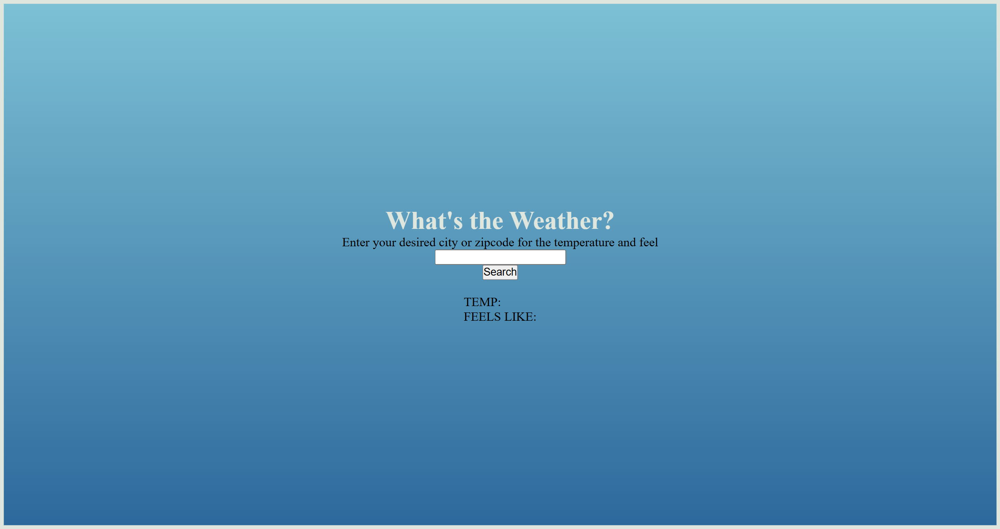

# 🌦 Project: Weather API

### Goal: Enable your user to enter a city + country and return the temperature in Fahrenheit

## Project Description

A simple web app to see the weather current weather in a city of your choosing. It uses api.weatherapi.com/v1/ API and take in a city or zipcode. These geographic coordinates are then sent to /api.weatherapi.com/ API to retrieve the current weather conditions and degrees in Fahrenheit.   

The application displays the current weather conditions of that location, and the degrees in Fahrenheit.  

## Tech Stack

- **HTML** 
- **CSS**
- **JavaScript**

## How to Run or View It

1. Clone or download the repository.
2. Open `index.html` in a browser or serve the project using a local development server.
3. Input a city or zipcode of your choosing
4. Click **search** to retrieve the local weather

The application requires an internet connection to access its external APIs. API availability and credential requirements may affect the results.
/api.weatherapi.com/ requires a key

## Screenshots and Demo

### Application Interface

.png)

The interface displays the current weather conditions of that location, and the degrees in Fahrenheit.